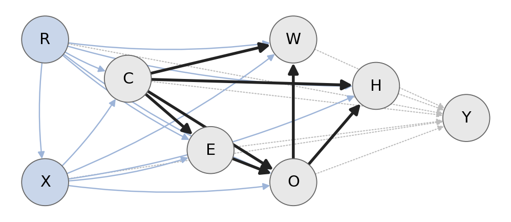

# Local Bayesian-Network Factor Adaptation for Fairness Transfer across States and Years

ICT 5143 capstone (Algorithms, Fairness and Graphical Models Laboratory) · **Problem 5: Fairness Transfer across States
and Years with Bayesian Networks**

All code is in one notebook: [problem5_fairness_transfer_bn.ipynb](problem5_fairness_transfer_bn.ipynb). Part 1
defines the code, Part 2 runs every experiment and writes `results/`.

## 1. Identity and task

| | |
|---|---|
| Team | Aslam Mugutkhan (261090830010) · Rao Ashlesha Padmananda (261090830019) |
| Dataset | U.S. Census Bureau ACS PUMS 1-Year person files, California, Texas, New York, 2018 and 2019, filtered to the Folktables **ACSIncome** population (six domains) |
| Y = 1 | annual income `PINCP` > \$50,000 (nominal; ACSIncome definition, verified row by row against `folktables`) |
| D = 1 | the model predicts high income. A benchmark classification, not a measure of merit, need or employability |
| Groups | 18 recorded race (`RAC1P`) × sex (`SEX`) cells, used as recorded |

## 2. Question and contribution

**Question.** With only n = 200 or 1,000 labelled target persons, does updating at most two shifted Bayesian-network
factors keep equalized odds better than updating every factor, target threshold adjustment, or global covariate
reweighting, while losing at most 0.02 balanced accuracy? (Falsified, per comparator, if the Holm-adjusted paired
household-bootstrap test shows no reduction in mean target ΔEOdds.)

**Closest method reproduced.** Covariate-shift fairness correction (Shimodaira 2000; Singh et al. 2021; Rezaei et al.
2021) as **IW-EO**: domain-classifier importance weights, weighted refit, equalized-odds post-processing. Graph-based
diagnosis of fairness-transfer failure (Schrouff et al. 2022) is the closest idea; it diagnoses but does not repair.

**Contribution (BN-LFA).** Per factor, a Bayes factor of "shifted" (model averaging over structured shift families) and
the exact change of the source rule's ΔEOdds and balanced accuracy if only that factor is updated; update ≤ 2 factors
with log BF > 0 ranked by P(shift) × impact; refit equalized-odds thresholds on the source validation split reweighted by
the density ratio of the updated factors only (with nothing selected it is exactly the source fair rule).

**Limitations.** Associational graph; three states and two years; small race groups cannot be assessed; deterministic
thresholds; the nominal \$50k label. See [docs/assumptions.md](docs/assumptions.md).

## 3. Model and fairness

All eight variables are observed (no latent variables): race R, sex X, age C, education E, class of worker W,
occupation O, hours H, income Y. Constrained hill climbing on validation log-likelihood (tiers {R,X} → C → E → {W,O} → H,
required R, X parents, in-degree ≤ 4) learned the same structure in all six domains:

P(V) = P(R) P(X∣R) P(C∣R,X) P(E∣R,X,C) P(O∣R,X,C,E) P(W∣R,X,C,O) P(H∣R,X,C,O) P(Y∣R,X,C,E,W,O,H)

with hierarchically smoothed Dirichlet CPTs and a log-linear outcome CPD tabulated over 57,600 parent configurations.
Inference query: P(G = g, pa(Y), Y), which gives the exact model-implied group TPR and FPR of any decision rule.
Variable elimination (four orders), a clique tree, enumeration and pgmpy agree to 1.3 × 10⁻¹⁵ (tolerance 10⁻⁹).

**Primary fairness criterion:** equalized odds within each target domain, ΔEOdds = max(TPR range, FPR range) across
groups with ≥ 100 positives and ≥ 100 negatives in the test split. Rationale: the errors of a favourable classification
should not depend on the group given the true label. Demographic parity, equal opportunity and calibration are audits.
**Utility:** balanced accuracy, allowed loss δ = 0.02. Race and sex are used at prediction time (as features and for
group thresholds) by every method except LR-S, GBT-S and RW-S.

## 4. Results

Mean over the nine transfers (CA↔TX↔NY 2018, and 2018 → 2019 within each state) and five seeds; target test splits of
20,681–39,551 persons.

| Method | BA, n = 200 / 1,000 | ΔEOdds, n = 200 / 1,000 | Log loss / Brier (n = 1,000) |
|---|---|---|---|
| EO-S (keep the source fair rule, no target labels) | 0.771 / 0.771 | 0.150 / 0.150 | 0.448 / 0.147 |
| TT (target threshold adjustment) | 0.768 / 0.772 | 0.192 / 0.205 | 0.448 / 0.147 |
| IW-EO (closest baseline) | 0.770 / 0.769 | 0.159 / 0.156 | 0.449 / 0.147 |
| LR-T (retrained on the target labels) | 0.738 / 0.763 | 0.521 / 0.453 | 0.461 / 0.151 |
| BN-all (update every factor) | 0.768 / 0.770 | 0.167 / 0.147 | 0.445 / 0.146 |
| **BN-LFA (proposed)** | **0.770 / 0.770** | **0.153 / 0.140** | 0.445 / 0.146 |

Confirmatory paired differences, BN-LFA minus comparator (household bootstrap B = 2,000, 95 % CI, Holm over 6 tests):

| Comparator | n = 200 | n = 1,000 |
|---|---|---|
| TT | −0.039 [−0.045, −0.030], p = 0.006 | −0.065 [−0.070, −0.047], p = 0.006 |
| BN-all | −0.014 [−0.020, −0.004], p = 0.032 | −0.008 [−0.013, 0.001], p = 0.246 |
| IW-EO | −0.006 [−0.011, 0.003], p = 0.246 | −0.016 [−0.022, 0.001], p = 0.222 |

Balanced accuracy is non-inferior (95 % lower bound > −0.02) in all six tests, and matched within 0.003 across methods.

* **Answer: partially supported.** BN-LFA beats target thresholds at both budgets and all-factor updating at n = 200,
  but not covariate reweighting. Against keeping the source rule (exploratory) the gain is not significant: −0.010
  [−0.018, 0.004] at n = 1,000. The source rule degraded little after zero-label transfer (+0.028 on average).
* **Probabilistic quality.** Held-out joint log-likelihood per person: source BN −8.898; at n = 200 updating every
  factor worsens it (−8.926) while BN-LFA improves it (−8.873). Group calibration of the score model after transfer:
  ECE ≤ 0.10 for every well-supported group.
* **Group support.** 7–10 groups per test split have ≥ 100 positives and negatives; American Indian, Alaska Native,
  AIAN-other and NHPI cells mostly have fewer than 30 and are reported as exploratory with their denominators.
* **Mechanism.** The factor diagnostic tracks the fairness change (Spearman 0.88 across the nine pairs, exploratory);
  education P(E∣R,X,C) and the outcome factor drive it; race composition shifts most but barely matters.
* **Failure case.** When three factors shift but only two may be updated (synthetic), BN-LFA is no better than doing
  nothing (0.187 vs 0.184); with coarse feature bins it is less fair than EO-S (0.150 vs 0.145).

Full results: [results/results_summary.md](results/results_summary.md), [results/tables/](results/tables),
[results/metrics/](results/metrics), [results/figures/](results/figures), the 3-page
[report](report/AFGML_Report.pdf) and the [requirement matrix](docs/requirements_matrix.md).

## 5. How to run

**Google Colab (recommended).** Upload `problem5_fairness_transfer_bn.ipynb`, choose a CPU runtime and *Runtime → Run
all*. Nothing else is needed: the first cell installs the three optional cross-check packages (`folktables`, `pgmpy`,
`fairlearn`) without touching Colab's own libraries, and the data (ACS PUMS, 300 MB, public, no account needed) are
downloaded from the U.S. Census Bureau; their SHA-256 hashes are written to `results/tables/data_provenance.csv` (compare
with [data/checksums.sha256](data/checksums.sha256)). The reported run took 13 minutes on a standard Colab CPU runtime
(2 CPUs), including the download; at the end `p5_results.zip` is downloaded. Set `RUN_MODE = "quick"` in the settings cell for a shorter check whose numbers must
not be reported.

**Locally (optional).** Python 3.13 with the packages in [requirements.txt](requirements.txt), then run all cells in
Jupyter from this folder; `data/` and `results/` are created next to the notebook (about 30 minutes on a 4-core laptop
CPU, about 4 GB RAM).

**Reported run and library versions.** `results/` is the Colab run of 6 November 2026 (Python 3.13.18, numpy 2.4.6,
pandas 2.2.3, scipy 1.16.3, scikit-learn 1.6.1; all versions in `results/reproducibility.json`). An earlier local run
with scikit-learn 1.9.1 gave the same results to at least seven decimal places, except the GBT-T retraining baseline,
whose boosted trees differ slightly between scikit-learn versions (largest change: mean ΔEOdds 0.453 vs 0.461 at
n = 200). No reported comparison involves GBT-T.

**What the notebook writes:** `results/metrics` (per-run, per-group and paired results), `results/tables`,
`results/figures` (the compact figures used in the report and slides are in `results/figures/report/`), `results/logs`
(structure-search history, failed configurations), `results/results_summary.md`, `results/reproducibility.json`
(settings, versions, data provenance, validation checks) and `results/manifest.csv` (every artifact with its stage,
settings hash, data version and SHA-256). Section 2.5 runs the self-checks (factor algebra, exact-inference agreement,
d-separation, metric edge cases, Holm, household splits, and a leakage check that shuffles the test labels); section
2.12 is the demonstration ([demo/README.md](demo/README.md)).

## 6. Evidence

| Document | Content |
|---|---|
| [docs/proposal.md](docs/proposal.md) | question, contribution sentence, preregistered choices, dated amendment log |
| [docs/protocol.md](docs/protocol.md) | splits, selection, metrics, seeds, uncertainty, confirmatory family, estimand, correctness checks |
| [docs/requirements_matrix.md](docs/requirements_matrix.md) | every common and Problem 5 requirement → notebook section, artifact, status, report/slide |
| [docs/related_work.md](docs/related_work.md) | 16 verified papers, closest reproduced baseline |
| [docs/data_card.md](docs/data_card.md), [docs/model_card.md](docs/model_card.md) | data and model cards |
| [docs/assumptions.md](docs/assumptions.md) | numbered assumptions, checks, sensitivity tests, target data per stage |
| [report/AFGML_Report.pdf](report/AFGML_Report.pdf) | 3-page report (source `report/AFGML_Report.tex`) |
| [slides/AFGML_Slides.pdf](slides/AFGML_Slides.pdf) | 10 + 3 Beamer slides (source `slides/AFGML_Slides.tex`) |
| [demo/README.md](demo/README.md) | demonstration and saved trace |
| Manuscript (8–10 pages) | editable draft: <https://claude.ai/artifact/NLUw8rk13vDvPgB7cWWczL> |

## 7. Contributions and attribution

Contribution table and individual statements: [docs/contributions.md](docs/contributions.md) (to be completed by both
students). Data: U.S. Census Bureau ACS PUMS (public domain; cite the Census Bureau). Benchmark definition: Folktables
(Ding et al., NeurIPS 2021; MIT). Libraries: numpy, pandas, scipy, scikit-learn, matplotlib, networkx, pgmpy,
fairlearn, folktables (licences in [LICENSE](LICENSE)). No code was copied from the cited papers.
Assistance disclosure: [complete as required by the course policy].

Code licence: MIT ([LICENSE](LICENSE)).
